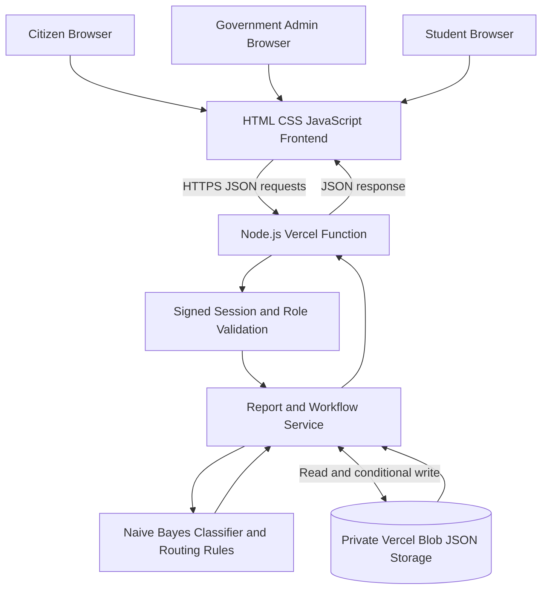
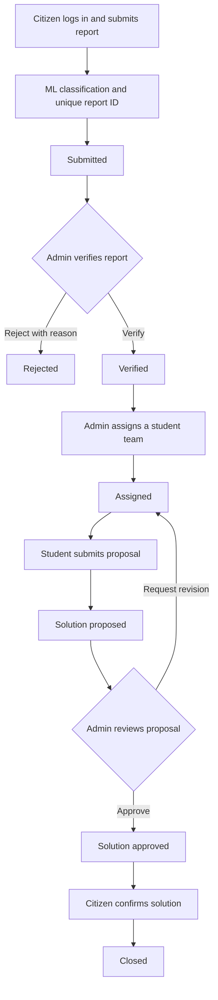

# Samadhan Setu

**A community problem reporting and collaborative solution development platform**

[Live Demo](https://samadhan-setu-lemon.vercel.app) · [Source Code](https://github.com/harshbarnawa/samadhan-setu)

    

> Academic mini-project and functional prototype. Government officials and institutional teams are simulated. This website is not an official government service.

## Overview

Samadhan Setu connects citizens, simulated government administrators and student teams in a single platform. Citizens report community issues such as damaged roads, unsafe drinking water, electricity outages and waste management problems. A lightweight machine-learning classifier suggests a category, department and relevant engineering expertise. An administrator verifies and assigns reports, student teams propose solutions, and citizens can track the progress and confirm closure.

The distinguishing idea is to turn civic complaints into practical, real-world learning and innovation opportunities for students rather than treating them solely as administrative tickets.

## Features

- Separate citizen, government administrator and student demo login portals.
- Citizen report submission with title, description, manually entered location and optional photo.
- Unique report ID and progress tracking.
- Local multinomial Naive Bayes text classification, with manual review for uncertain reports.
- Rule-based priority estimation, department mapping and recommended expertise.
- Admin verification, rejection with reason, team assignment and proposal review.
- Admin edit controls for category, priority, status, assigned team and review note.
- Student dashboard for assigned challenges and solution proposals.
- Proposal approval, revision and citizen confirmation.
- Shared cloud persistence across browsers, basic analytics, status filters and manual/periodic refresh.
- Server-side signed sessions, role checks and workflow validation.

## Technology Stack

| Layer | Technology | Purpose |
| --- | --- | --- |
| Frontend | HTML5, CSS3, Vanilla JavaScript | Responsive interface, forms, dashboards, analytics |
| Backend | Node.js, Vercel Functions | HTTP JSON API, authentication and report operations |
| Storage | Private Vercel Blob, `@vercel/blob` | Shared JSON document containing report records and compressed photos |
| Machine learning | Multinomial Naive Bayes (JavaScript) | Text-based issue categorization |
| Decision rules | Keyword rules and lookup tables | Priority, department and expertise suggestions |
| Authentication | Node.js crypto, HMAC-SHA256, HTTP-only cookies | Signed demo-role sessions |
| Version control | Git, GitHub | Source management |
| Deployment | Vercel | Hosting and automatic deployments from main |

No paid AI API, external LLM, model-serving infrastructure, Express server, or relational database is required. The deployment uses Vercel Hobby resources; provider usage limits apply.

## System Architecture

The project follows a three-tier architecture with an embedded ML module in the application layer.



- **Presentation layer:** login screens, reporting form and role-specific dashboards in `index.html`. A client-side classifier provides an immediate preview.
- **Application layer:** `api/session.js` verifies demo credentials, signs sessions and checks the authenticated role. `lib/reports.js` classifies submissions on the server, validates changes and controls report visibility.
- **Data layer:** a private Blob JSON object, `samadhan-reports-v3.json`, persists reports, team assignments, notes, status and compressed images. Conditional writes with ETags and retries help prevent concurrent writes from overwriting each other.
- **Synchronization:** each authenticated browser reads the same shared storage through the API. Visible dashboards poll every 12 seconds and provide a manual Refresh button. Changes may be deferred while a form is being edited.

## Project Workflow



### Roles and responsibilities

| Role | Actions |
| --- | --- |
| Citizen | Submit reports, view shared citizen demo reports, search by ID, confirm approved solution |
| Government administrator | Review, verify, reject, assign, edit category/priority/status/team/note, approve or request revision |
| Student | View assigned reports, submit and revise solution proposals |

Each role has its own sign-in screen. The admin may override report status through the Edit form, subject to server-side validation of category, priority, team and required proposal/rejection reason.

## How the ML Module Works

The classifier uses a small built-in training dataset: three example text snippets for each of seven categories (21 examples in total).

1. Convert the text to lowercase and extract Latin-alphabet words.
2. Count words from training data for each category.
3. Calculate smoothed category likelihoods using multinomial Naive Bayes in log space, assuming equal class priors.
4. Select the highest-scoring category, or return **Other / review** if no known words are found or the scores are too close.
5. Map the result to a suggested department and engineering expertise using lookup tables.
6. Estimate urgency separately using simple safety-related keywords.

Example input: `Road potholes caused an accident in our village.`

| Output | Example |
| --- | --- |
| Category | Infrastructure |
| Priority | High |
| Suggested department | Public Works Department |
| Recommended expertise | Civil Engineering |

Categories: Infrastructure, Water supply, Electricity, Sanitation, Education, Healthcare and Agriculture. Some Roman Hindi vocabulary is supported. This is a lightweight educational classifier, not a validated multilingual or image-analysis model. Admin review remains necessary.

## API Reference

All operations use the same endpoint, `/api/session`, with a JSON request body for POST requests.

| Method | Action | Purpose |
| --- | --- | --- |
| GET | — | Read current authenticated role |
| POST | login (role, email, password; no action required) | Sign in and set a signed session cookie |
| POST | logout | Clear session |
| POST | list | Fetch role-visible reports |
| POST | mutate | Apply an authorized workflow operation |
| POST | check | Check permission for a supported operation |

Mutation operations: `report`, `verify`, `reject`, `assign`, `solution`, `approve`, `revise`, `confirm`, `edit`. The server validates roles and normal status transitions before persisting changes.

## Data Model

A report contains a unique ID, title, description, location, optional compressed JPEG photo, category, priority, suggested department, recommended expertise, status, optional assigned team, admin note and student solution.

Images are stored as compressed data URLs inside the JSON records for simplicity. The current prototype limits the dataset to 50 total records, including example reports. This is object storage, not a relational database.

## Repository Structure

```text
samadhan-setu/
├── api/
│   └── session.js       # Login, session and API routing
├── lib/
│   └── reports.js       # ML, workflow rules and shared persistence
├── index.html           # Frontend pages, styles and client logic
├── package.json         # Project dependency configuration
└── README.md
```

## Setup and Deployment

Prerequisites: Node.js, npm, a Vercel account and a connected private Vercel Blob store.

```bash
git clone https://github.com/harshbarnawa/samadhan-setu.git
cd samadhan-setu
npm install
npx vercel link
npx vercel env pull .env.local
npx vercel dev
```

Configure the following environment variables in the Vercel project settings before deployment:

| Variable | Description |
| --- | --- |
| SESSION_SECRET | Strong random secret for HMAC session signatures |
| CITIZEN_PASSWORD | Citizen demo account password |
| ADMIN_PASSWORD | Government administrator demo password |
| STUDENT_PASSWORD | Student demo account password |
| BLOB_READ_WRITE_TOKEN | Private Blob storage token supplied by Vercel |

The corresponding email addresses are `citizen@samadhan.demo`, `admin@samadhan.demo` and `student@samadhan.demo`. Obtain demo passwords from the project maintainer; do not commit secrets or environment files. The hosted HTTPS deployment is recommended for testing secure-cookie authentication. Local testing may require HTTPS or browser-specific secure-cookie handling.

Push to the linked GitHub main branch to deploy through Vercel.

## Presentation / Dry Run

Use three separate browser profiles or different browsers for simultaneous sessions.

| Step | Action | Expected result |
| --- | --- | --- |
| 1 | Citizen submits a new damaged road complaint | Report ID generated, status Submitted |
| 2 | Admin refreshes and verifies complaint | Verified |
| 3 | Admin assigns Civil Engineering Team | Assigned and visible to student |
| 4 | Student submits a road repair proposal | Solution proposed, visible to admin |
| 5 | Admin approves proposal | Solution approved, visible to citizen |
| 6 | Citizen confirms | Closed |
| 7 | Admin edits another report | Updated fields persist after refresh |

For a rejection demonstration, use a separate sample report and enter a rejection reason. A revision request returns a proposed solution to the Assigned stage.

### Verification status

The backend workflow logic was exercised with isolated sample-data tests covering submission, classification, role visibility, unauthorized verification, assignment, proposal, revision, approval, closure and admin edit. All ten checks passed. The production deployment returned READY. Live multi-browser persistence and full browser integration still require a manual dry run; isolated checks do not prove cloud storage or deployed API connectivity.

## Limitations and Future Scope

- Accounts are shared demo identities by role, not individual registered users or separately authenticated student teams.
- Government verification and institutional collaboration are simulated; no real government integration.
- Approving a proposed solution does not demonstrate actual physical implementation.
- Small training dataset and limited Roman Hindi vocabulary; no measured model accuracy claim.
- No GPS map, real-time push, image recognition, notification service or external government database.
- Object storage and periodic polling suit a small demo, not a high-volume public complaint service. Do not submit real personal or sensitive information.

Potential extensions include individual user registration, team-level authorization, relational database, separate image storage, audit trails, map integration, richer multilingual classification and official stakeholder onboarding.

## Project Purpose

Developed as a college mini-project demonstrating full-stack development, basic machine learning, role-based workflow management and shared cloud persistence.

**Samadhan Setu — from a citizen's problem report to a collaborative solution.**
